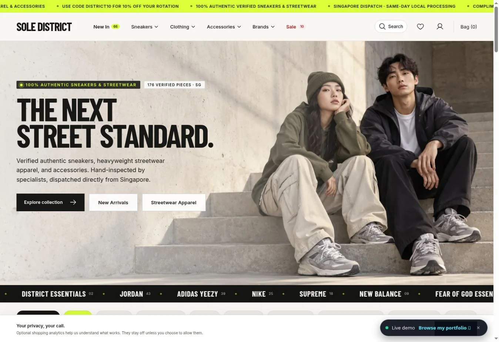

# SOLE DISTRICT

A streetwear commerce portfolio project with a React storefront, a Django merchant workspace and size-level inventory.

**[Live demo](https://sole-district-green.vercel.app/)** · [Portfolio case study](https://teddy-qyuon-portfolio.vercel.app/projects/sole-district)



## Scope and contribution

An AI-assisted personal project by Wai Yan Hpone Lat. The storefront connects customer browsing, size selection, a persistent bag and checkout with catalogue, stock and fulfilment workflows for staff.

Catalogue records, prices and stock are portfolio data. Supplier authenticity and physical inventory have not been independently verified; no commercial performance is claimed. Review the [commerce activation guide](docs/COMMERCE_ACTIVATION.md) before enabling real sales.

## Stack

React, Vite, JavaScript, CSS, Python, Django, PostgreSQL and Stripe. SQLite supports local development.

## Run locally

Use Python 3.12 and Node.js. Create and activate a Python virtual environment, then:

```bash
git clone https://github.com/TeddyQyuon/sole-district.git
cd sole-district
python -m pip install -r backend/requirements.lock
```

Copy `backend/.env.example` to `backend/.env` and configure local settings. In a backend terminal:

```bash
cd backend
python manage.py migrate
python manage.py seed_catalog
python manage.py bootstrap_roles
python manage.py createsuperuser
python manage.py runserver 127.0.0.1:8000
```

In a second terminal at the repository root:

```bash
npm ci
npm run dev
```

Vite proxies `/api` to Django. The storefront is at `http://localhost:5173`, the merchant workspace at `/manage`, and Django admin at `/django-admin/`.

## Checks

```bash
npm run test:sites
npm run build
cd backend
python manage.py check
python manage.py test
python manage.py makemigrations --check --dry-run
```

PostgreSQL is needed to exercise database row-lock concurrency. Use a disposable local or CI database for those tests.

## Developer notes

- [Vercel service configuration](vercel.json).
- [Commerce configuration and operational requirements](docs/COMMERCE_ACTIVATION.md)
- Artwork provenance: `public/assets/payment-brands/sources.json`.

Keep credentials in server environment settings. Signed Stripe webhooks determine payment completion; a checkout redirect is not proof of payment.
